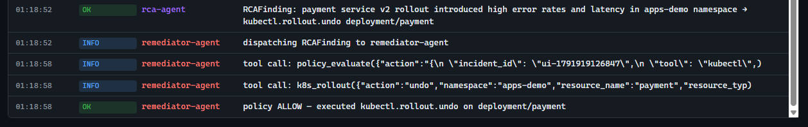

# Athena — SRE Agent

Multi-agent incident-response pipeline on
[kagent](https://github.com/kagent-dev/kagent) — three agents
(`trace-agent` → `rca-agent` → `remediator-agent`) detect, diagnose, and
fix production incidents on a 3-service demo app. Every write to the
cluster is gated by OPA policy. Driven by a single click in the
`apps/demo-control` UI, with read-only observability on Prometheus +
Loki + Tempo.

## Architecture


## Worked example, one click, full recovery


### Live agent activity (inject -> rca-agent -> remediator-agent -> policy ALLOW -> rollout undo)


<br/>



The first screenshot shows rca-agent dispatching, making the two budgeted tool
calls (`k8s_get_resources deployment/payment` + `k8s_get_resources pod`), and
emitting a clean RCAFinding. The second screenshot picks up where
remediator-agent takes over: it calls `policy_evaluate`, then `k8s_rollout
action=undo`, and the policy decision returns ALLOW. Total wall-clock: ~12s
from injection to `kubectl rollout undo` complete.

---

## How to run

### 1. Prerequisites

| Tool | Version | Notes |
|---|---|---|
| `docker` | 24+ | with the kind Docker driver |
| `kind` | 0.23+ | `brew install kind` / `choco install kind` |
| `kubectl` | 1.31+ | matches the kind k8s version |
| `helm` | 3.14+ | for the observability + kagent charts |
| `make` | any | the entry point for the whole POC |
| 8 GB free RAM | — | the cluster + obs stack + 3 LLM agents |

### 2. Clone and configure

```bash
git clone https://github.com/<your-org>/sre-agent.git
cd sre-agent
cp .env.example .env
```

Open `.env` and set the one required value:

```bash
# .env (the only field you must change to run the POC)
GEMINI_API_KEY=AIza...   # free at https://aistudio.google.com/apikey
```

`SLACK_WEBHOOK` is optional — leave it empty if you don't want on-call
notifications; the pipeline still runs end-to-end without it. The other
fields in `.env.example` (OpenAI / Anthropic / Ollama) are only needed if
you swap `manifests/agents/*.yaml` to point at a different
`modelConfig:`.

### 3. Bring the cluster up

```bash
make poc-up
```

`poc-up` is a single Makefile target that creates the `sre-poc` kind
cluster, installs the observability stack + demo services + OPA, deploys
all 8 MCP shims + 3 kagent agents, and loads the `<name>:dev` images.

If a step fails partway, finish manually with `bash scripts/deploy-missing.sh`.

### 4. Open the UIs

```bash
./scripts/port-forwards.sh
```

This prints every URL with the correct host binding for your OS
(Windows host IP, or `127.0.0.1` on Linux/macOS). The key one:

| URL | What's there |
|---|---|
| http://localhost:15000 | **Demo Control** — click "Inject + Auto-fix: payment v2" to drive the full loop |
| http://localhost:18080 | kagent chat UI |
| http://localhost:13000 | Grafana |
| http://localhost:19091 | Prometheus |
| http://localhost:19092 | Alertmanager |

On Windows, the k8s dashboard needs a token:

```bash
kubectl --context kind-sre-poc -n kubernetes-dashboard create token admin-user --duration=24h
# paste the token at http://localhost:18443
```

### 5. Drive the demo

Open http://localhost:15000 and click **"Inject + Auto-fix: payment v2"**.
The services table will flip `payment` to `degraded / v2 / slow / 50%`,
then the agents will run, then the policy ALLOW will trigger
`kubectl rollout undo` and flip `payment` back to `healthy / v1 / fast / 0%`
in about 30 seconds end-to-end. The activity log on the right shows every
tool call, the RCAFinding, the policy decision, and the rollout.

---

## Pipeline (one click to recovery)

```
+-------------------+
|   demo-control    |  (apps-demo ns)
+---------+---------+
          |
          | 1. PATCH deployment/payment env (v2, slow, 50% errors)
          | 2. POST IncidentContext -> kagent-controller:8083
          v
+-------------------+
|   kagent Ctrl     |  (v0.7.2)
+---------+---------+
          |
          | 3. A2A dispatch
          v
+-------------------+         +-------------------+
|     rca-agent     |  peer   |   trace-agent     |
|   (reasoner)      |  call   |    (read-only)    |
+---------+---------+ <-----> +-------------------+
          |
          | 4. reads runbook (git-mcp), k8s state
          | 5. emits typed RCAFinding
          v
+-------------------+
|   demo-control    |  (chains the RCAFinding)
+---------+---------+
          |
          | 6. POST RCAFinding -> kagent-controller
          v
+-------------------+
| remediator-agent  |  (scoped RW)
+---------+---------+
          |
          | 7. policy_evaluate(action)
          v
+-------------------+    +-------------+    +---------+
|  policy-mcp-shim  | -> |  policy-mcp | -> |   OPA   |
+-------------------+    +-------------+    +---------+
          |
          | 8. on allow=true: k8s_rollout(action=undo)
          v
+-------------------+
|   kagent-tools    |  (kubectl under the hood)
+---------+---------+
          |
          v
+---------------------------------------+
|  Kubernetes rolls payment back:      |
|       v2 -> v1   (~30s)               |
+---------------------------------------+
          |
          v
   demo-control polls at 2 Hz,
   services table flips back to green
```

**Why the chain is two steps**: kagent 0.7 rejects A2A peer refs that form
cycles (`rca <-> remediator`). The **caller (demo-control) chains them** via
two sequential A2A POSTs.

---

## Folder structure

```
sre-agent/
|-- Makefile                   # single entry point; `make help` lists targets
|-- README.md                  # this file
|-- PUKU.md                    # AI assistant context (not for humans)
|-- apps/
|   |-- demo-service/          # 3 microservices (Node.js + Express)
|   `-- demo-control/          # visual UI: inject + watch agents fix it
|-- infra/                     # Helm values (Prometheus, Loki, Tempo, OTel, Grafana)
|-- manifests/
|   |-- agents/                # trace-agent, rca-agent, remediator-agent
|   |-- dashboard/             # kubernetes-dashboard + admin-user
|   |-- mcp/                   # 8 RemoteMCPServer CRs
|   |-- modelconfig/           # gemini-2-flash-lite + secret
|   |-- rbac/                  # agent-read (RO) + agent-write (scoped RW)
|   |-- ui-nodeports.yaml      # high-port NodePorts for observability UIs
|   `-- webhook/               # AlertmanagerConfig -> rca-agent bridge
|-- mcp-servers/               # 8 Python MCP shims
|-- policy/                    # OPA Rego + policy-mcp (Node.js) + tests
|-- scenarios/                 # legacy CLI inject scripts (replaced by UI)
|-- scripts/                   # bring-up, port-forwards, dashboard token
|-- schemas/                   # A2A JSON contracts (ajv-validated)
|-- tests/                     # ajv + OPA sync + YAML lint
`-- docs/
    |-- archify/               # interactive archify diagram source + render
    `-- images/                # architecture PNG, dashboard screenshot
```

---

## Common workflows

| Goal | Command |
|---|---|
| Bring everything up | `make poc-up` |
| Visual driver | open the demo-control URL from port-forwards.sh |
| Status of all pods | `make status` |
| Tail all agent logs | `make logs` |
| Run schema + policy tests | `make test` |
| Re-render archify diagram | `make archify-sre-agent` |
| Fresh k8s dashboard token | `kubectl --context kind-sre-poc -n kubernetes-dashboard create token admin-user --duration=24h` |
| Tear down | `make poc-down` |

---

## UIs

The port-forwards script (`./scripts/port-forwards.sh`) prints every URL on
startup, with the correct host binding for your machine (host IP on Windows
to bypass `wslrelay`, or `127.0.0.1` on Linux/macOS).

| UI | What it is |
|---|---|
| demo-control | the visual driver (inject + watch) |
| kagent chat UI | controller chat |
| Kubernetes Dashboard | cluster admin UI (token login) |
| Grafana | dashboards + Explore for Prom/Loki/Tempo |
| Prometheus | metrics + alerts |
| Alertmanager | alert routing |

---

## Safety guarantees

1. **Schema enforcement**: every A2A message validated with `ajv`.
2. **OPA policy gate**: `policy_evaluate` blocks writes outside the allow-list
   (`apps-demo`, `agent-write`), with confidence >= 0.7, risk != high.
3. **Namespace isolation**: `agent-read` SA is `view` cluster-wide;
   `agent-write` SA is scoped to specific verbs in `apps-demo`.
4. **Default-deny**: if OPA errors or times out, the wrapper returns
   `allow:false` (verified by smoke test).

---

## Out of scope

Multi-cluster, fine-tuning, real PagerDuty, persistent RCA beyond 7 days.
