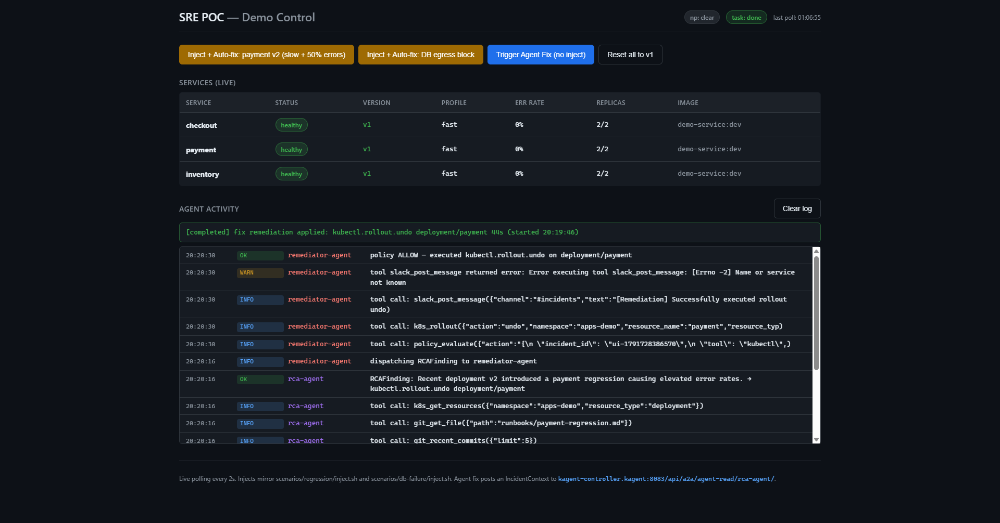

# Multi-Agent SRE POC — kagent on Kubernetes

3-agent incident-response pipeline (`trace-agent → rca-agent → remediator-agent`)
on [kagent](https://github.com/kagent-dev/kagent), gated by OPA, with read-only
observability on Prometheus + Loki + Tempo. UI-driven by a single click in
`apps/demo-control` (http://localhost:15000).

## Architecture


## Worked example — one click, full recovery



---

## How to run

```bash
export GOOGLE_API_KEY=AIza...        # free at https://aistudio.google.com/apikey
export SLACK_WEBHOOK_URL=https://hooks.slack.com/...    # optional
make poc-up                          # cluster + obs stack + demo + agents + OPA
./scripts/port-forwards.sh           # host-side forwards (background)
# Open http://localhost:15000 → click "Inject + Auto-fix: payment v2"
```

If a step in `poc-up` fails partway, finish manually with `bash scripts/deploy-missing.sh`.

---

## Pipeline (one click → recovery)

```
demo-control UI  (apps-demo ns, :15000)
     │ 1. PATCH deployment/payment env (v2, slow, 50% errors)
     │ 2. POST IncidentContext → kagent-controller:8083
     ▼
kagent Ctrl (v0.7.2)
     │ 3. A2A dispatch
     ▼
rca-agent  ──(peer call)──▶  trace-agent
     │ 4. reads runbook (git-mcp), k8s state
     │ 5. emits typed RCAFinding
     ▼
demo-control  (chains the RCAFinding)
     │ 6. POST RCAFinding → kagent-controller
     ▼
remediator-agent
     │ 7. policy_evaluate(action)  →  policy-mcp-shim → policy-mcp → OPA
     │ 8. on allow=true: k8s_rollout(action=undo) → kagent-tools → API
     ▼
Kubernetes rolls payment back: v2 → v1   (~30s)
     │
     ▼
demo-control polls at 2 Hz, services table flips back to 🟢
```

**Why the chain is two steps**: kagent 0.7 rejects A2A peer refs that form
cycles (`rca ↔ remediator`). The **caller (demo-control) chains them** via
two sequential A2A POSTs.

---

## Folder structure

```
sre-agent/
├── Makefile                   # single entry point — `make help` lists targets
├── README.md                  # this file
├── PUKU.md                    # AI assistant context (not for humans)
├── apps/
│   ├── demo-service/          # 3 microservices (Node.js + Express)
│   └── demo-control/          # visual UI: inject + watch agents fix it
├── infra/                     # Helm values (Prometheus, Loki, Tempo, OTel, Grafana)
├── manifests/
│   ├── agents/                # trace-agent, rca-agent, remediator-agent
│   ├── dashboard/             # kubernetes-dashboard + admin-user
│   ├── mcp/                   # 8 RemoteMCPServer CRs
│   ├── modelconfig/           # gemini-2-flash-lite + secret
│   ├── rbac/                  # agent-read (RO) + agent-write (scoped RW)
│   ├── ui-nodeports.yaml      # high-port NodePorts for observability UIs
│   └── webhook/               # AlertmanagerConfig → rca-agent bridge
├── mcp-servers/               # 8 Python MCP shims
├── policy/                    # OPA Rego + policy-mcp (Node.js) + tests
├── scenarios/                 # legacy CLI inject scripts (replaced by UI)
├── scripts/                   # bring-up, port-forwards, dashboard token
├── schemas/                   # A2A JSON contracts (ajv-validated)
├── tests/                     # ajv + OPA sync + YAML lint
└── docs/
    ├── archify/               # interactive archify diagram source + render
    └── images/                # architecture PNG, dashboard screenshot
```

---

## Common workflows

| Goal | Command |
|---|---|
| Bring everything up | `make poc-up` |
| Visual driver | open http://localhost:15000 |
| Status of all pods | `make status` |
| Tail all agent logs | `make logs` |
| Run schema + policy tests | `make test` |
| Re-render archify diagram | `make archify-sre-agent` |
| Fresh k8s dashboard token | `kubectl --context kind-sre-poc -n kubernetes-dashboard create token admin-user --duration=24h` |
| Tear down | `make poc-down` |

---

## UIs (host-side)

| UI | URL | Notes |
|---|---|---|
| demo-control | http://localhost:15000 | the visual driver |
| kagent chat UI | http://localhost:18080 | controller chat |
| Kubernetes Dashboard | https://localhost:18443 | token login |
| Grafana | http://\<host-IP\>:13000 | use `ipconfig` IP, not `localhost` |
| Prometheus | http://\<host-IP\>:19090 | no auth |
| Alertmanager | http://\<host-IP\>:19093 | no auth |

**Why the host IP, not `localhost`**: `wslrelay.exe` on Windows binds to
`127.0.0.1` for many high ports, intercepting the kind NodePort mappings
before they reach Docker. Use the IPv4 from `ipconfig` to bypass it.

---

## Safety guarantees

1. **Schema enforcement** — every A2A message validated with `ajv`.
2. **OPA policy gate** — `policy_evaluate` blocks writes outside the allow-list
   (`apps-demo`, `agent-write`), with confidence ≥ 0.7, risk ≠ high.
3. **Namespace isolation** — `agent-read` SA is `view` cluster-wide;
   `agent-write` SA is scoped to specific verbs in `apps-demo`.
4. **Default-deny** — if OPA errors or times out, the wrapper returns
   `allow:false` (verified by smoke test).

---

## Conventions

- Cluster: `sre-poc` (kind). Always `--context kind-sre-poc`.
- LLM: Gemini 2 Flash Lite. Switch to OpenAI by editing
  `manifests/modelconfig/`.
- Image naming: `<name>:dev`, loaded with `kind load docker-image`.
- Don't replace the UI with bash scripts — `apps/demo-control` is canonical;
  `scenarios/*/inject.sh` are headless/CI only.

---

## Out of scope

Multi-cluster, fine-tuning, real PagerDuty, persistent RCA beyond 7 days.
